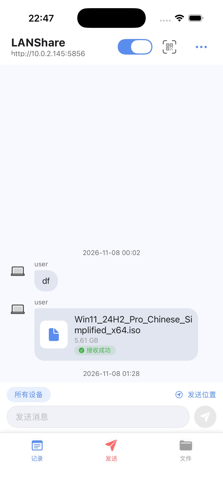
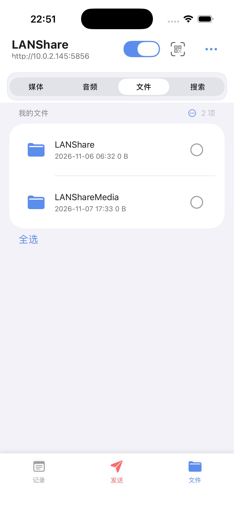
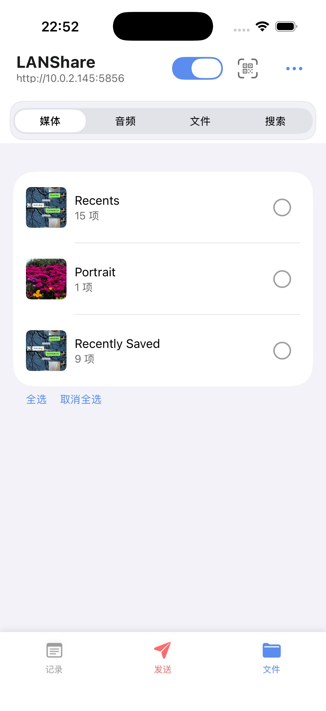
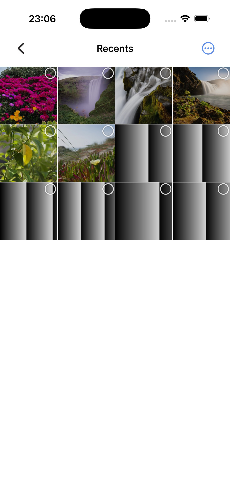
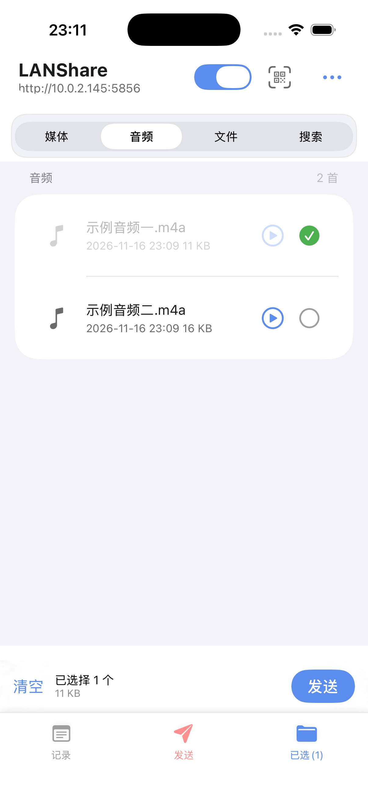
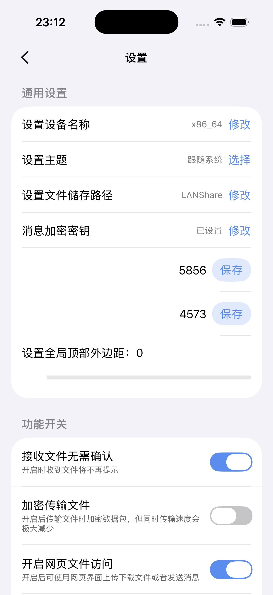
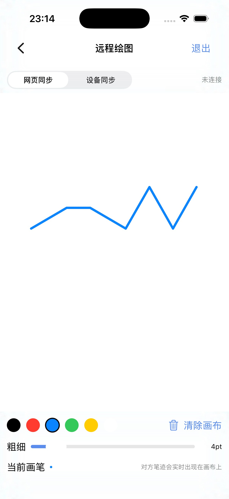

# LANShare — 局域网文件传输工具（iOS 版）

[]()
[]()
[]()
[]()

LANShare iOS 版是 [Android 版 LANShare](https://github.com/fgsq-team/LANShare) 的原生移植，使用 SwiftUI 构建。只要处于同一局域网内，即可自动发现设备并实现文件、消息、媒体等内容的快速互传，无需手动输入 IP 地址。

iOS 版与 Android / PC / Web 端**完全协议互通**：沿用同一套二进制协议（magic `0x66677371`、UDP/TCP 帧格式、DataEnc/DataDec 混淆、V4/V5 版本标记 `-2`/`-3`），并直接复用安卓版的 Web 前端资源，可与其它端无缝互传。

---

## 功能特性

- **自动设备发现** — 基于 UDP 广播，自动搜索同一局域网内的设备，无需手动配置
- **文件传输** — 基于 TCP（V4/V5 协议），支持各类文件快速传输与**断点续传**
- **消息发送** — 设备间文本消息实时发送；长文本自动改走 TCP；支持发送到对方剪贴板
- **文件浏览** — 内置文件浏览器，快捷选择文件/文件夹进行发送
- **媒体浏览** — 相册分类浏览图片/视频，支持整相册多选发送；音频独立浏览页
- **搜索** — 按类型检索本地文件与媒体
- **Web 文件服务** — 内置 HTTP 文件服务器 + WebSocket，浏览器即可访问/传输/管理（复用安卓 Web 前端）
- **媒体同步** — 支持设备间未同步媒体的补同步（V4/V5）
- **二维码** — 扫码添加设备、展示本机配对二维码（AVFoundation + CoreImage）
- **暗黑模式** — 深色/浅色/跟随系统主题切换
- **远程绘图** — 设备间实时双向绘图同步（V4 协议 TCP 长连接），并支持网页端 WebSocket 同步绘图；坐标归一化适配不同屏幕
- **位置消息** — 发送/接收地理位置消息
- **AES 加密** — 传输消息采用 AES 加密，保障数据安全
- **文件分类保存** — 接收文件按类型自动分类存储，可选自动保存到系统相册
- **消息分页** — 聊天记录分页加载，重启不重复拉取
- **换网自愈** — 监听网络变化（NWPathMonitor），切换 WiFi/网段变动后自动重绑监听 socket 并重新发现设备，无需重启 App

## 效果图

| 传输记录 | 文件浏览 | 相册分类 | 图片选择 |
|:---:|:---:|:---:|:---:|
|  |  |  |  |

| 图片预览 | 音频选择 | 应用设置 | 远程绘图 |
|:---:|:---:|:---:|:---:|
|  |  |  |  |

## 与安卓版的差异

受 iOS 平台限制，以下安卓功能**未移植**：

- APP 浏览与分享（iOS 无法读取/分享已安装应用安装包）
- 开机自启（iOS 不允许第三方常驻后台自启）
- 系统分享菜单外部共享（未提供 Share Extension）

其余功能均按安卓布局与行为复刻，并优先采用 iOS 原生组件（SwiftUI List / NavigationStack / PhotosPicker 等）。

## 技术原理

| 功能 | 协议/技术 |
|---|---|
| 设备发现 | UDP 广播 |
| 文件/长文本传输 | TCP（V4/V5） |
| 消息加密 | AES |
| Web 文件服务 | HTTP + WebSocket（内置 HttpServer 移植） |
| 远程绘图 | TCP（V4）+ WebSocket |
| 二维码 | AVFoundation（扫）+ CoreImage（生成） |
| 网络变化监听 | Network（NWPathMonitor） |
| 日志 | os.log（Logger） |

## 技术栈

- **语言**：Swift 5
- **UI**：SwiftUI（Combine 观察状态）
- **最低支持版本**：iOS 26.5
- **构建工具**：Xcode（xcodebuild）
- **网络**：BSD socket（Darwin）自实现 TCP/UDP，对齐安卓帧格式
- **存储**：SQLite3（消息/令牌/同步/续传记录）+ UserDefaults（偏好）
- **媒体**：Photos / AVFoundation / AVKit / ImageIO / QuickLook
- **第三方依赖**：无（协议与 Web 服务均为内置实现）

## 项目结构

```
LANShare-IOS/
├── LANShare.xcodeproj
├── img/                           # README 效果图
├── LANShare/
│   ├── LANShareApp.swift          # App 入口
│   ├── Assets.xcassets            # 图标（沿用安卓图标）
│   ├── Resources/web.bundle/      # 复用安卓 Web 前端资源
│   └── LANShare/
│       ├── LANService.swift       # 服务门面（发现/收发/消息/生命周期）
│       ├── Core/                  # 常量/命令码/二进制协议/加密/设备/网卡/设置/日志
│       ├── Data/                  # SQLite 数据库（消息/媒体索引/令牌/同步/续传）
│       ├── Net/                   # UDP/TCP 服务、文件收发、续传、绘图同步
│       ├── Views/                 # SwiftUI 界面（主框架/聊天/文件/媒体/设置/预览等）
│       └── Web/                   # 内置 HTTP 引擎 + WebSocket + 路由
└── .gitignore
```

## 构建

```bash
# 克隆项目
git clone https://github.com/fgsq-team/LANShare-IOS.git
cd LANShare-IOS

# 模拟器构建
xcodebuild -project LANShare.xcodeproj -scheme LANShare \
  -sdk iphonesimulator -destination 'generic/platform=iOS Simulator' build

# 真机 Archive（Release 需指定开发团队）
xcodebuild -project LANShare.xcodeproj -scheme LANShare \
  -configuration Release -sdk iphoneos -destination 'generic/platform=iOS' \
  -archivePath /tmp/LANShare.xcarchive \
  DEVELOPMENT_TEAM=<你的TeamID> CODE_SIGN_IDENTITY="Apple Development" \
  -allowProvisioningUpdates archive

# 导出 development ipa
xcodebuild -exportArchive -archivePath /tmp/LANShare.xcarchive \
  -exportPath ./build -exportOptionsPlist ExportOptions.plist
```

## 安装与分发

当前以 **ipa 自签**方式分发给具备动手能力的用户（正式上架 App Store 需付费开发者账号，后期盈利时再考虑）：

1. 获取 `LANShare.ipa`；
2. 用 **Sideloadly / AltStore / 爱思助手** 以**安装者自己的 Apple ID** 重签安装；
3. 设置 → 通用 → VPN与设备管理 中信任开发者证书；
4. 首次打开允许"本地网络"权限；
5. 免费 Apple ID 自签 **7 天**到期需重签（AltStore 可自动续）。

> 注意：ipa 为 development 签名，描述文件仅含打包者登记的设备；直接安装到未登记设备会失败，故接收者需自签。最低系统 iOS 26.5。

## 配置说明

| 配置项 | 默认值 | 说明 |
|---|---|---|
| UDP 端口 | 4573 | 设备发现广播端口 |
| TCP 端口 | 5856 | 文件传输 / Web 服务端口 |
| 文件保存路径 | 沙盒 `Documents/LANShare/` | 接收文件默认存储路径，可在设置中修改 |
| 扫描间隔 | 5 秒 | 局域网设备扫描时间间隔 |
| 设备超时 | 20 秒 | 无心跳设备剔除阈值 |

## 相关项目

- **LANShare（Android）**：[fgsq-team/LANShare](https://github.com/fgsq-team/LANShare)
- **HttpServer**：内置 HTTP 文件服务器 — [fgsq-team/HttpServer](https://github.com/fgsq-team/HttpServer)
- **LANShare-PC**：桌面端（Win / Mac / Linux）— [fgsq-team/LANShare-PC](https://github.com/fgsq-team/LANShare-PC)
- **LANShare-Harmony**：鸿蒙版（开发中）— [fgsq-team/LANShare-Harmony](https://github.com/fgsq-team/LANShare-Harmony)

## 问题反馈

如有问题或建议，欢迎通过以下方式联系：

- QQ 群：538809905
- [GitHub Issues](https://github.com/fgsq-team/LANShare-IOS/issues)

## License

```
Copyright 2021 fgsqme

Licensed under the Apache License, Version 2.0 (the "License");
you may not use this file except in compliance with the License.
You may obtain a copy of the License at

    http://www.apache.org/licenses/LICENSE-2.0

Unless required by applicable law or agreed to in writing, software
distributed under the License is distributed on an "AS IS" BASIS,
WITHOUT WARRANTIES OR CONDITIONS OF ANY KIND, either express or implied.
See the License for the specific language governing permissions and
limitations under the License.
```